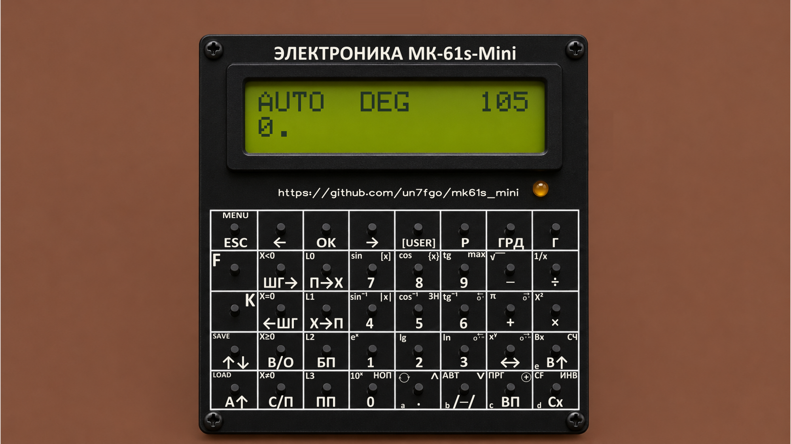
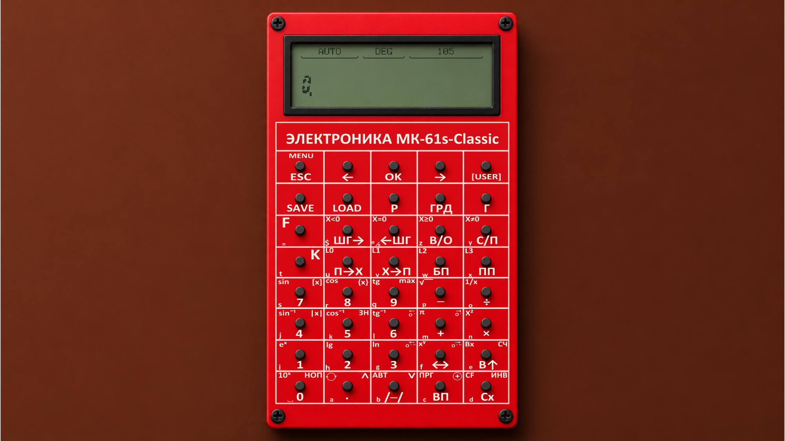
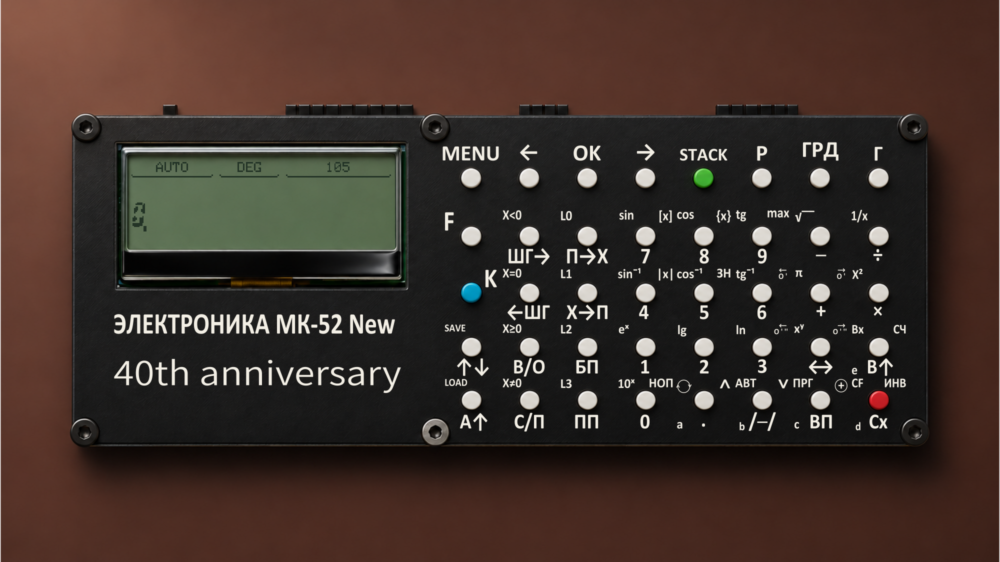
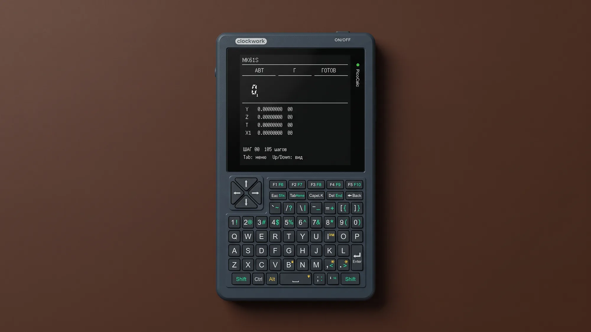

# MK61S

Эмулятор программируемого калькулятора «Электроника МК-61», который вырос
в небольшую ретроконсоль: с файлами, языками программирования, играми
и собственными приложениями. Общее ядро работает на платах mini, Classic,
40th и на PicoCalc с Raspberry Pi Pico H.

## Устройства

<table>
<tr>
<td width="50%" valign="top">

<h3>mini</h3>



<p>Компактная плата 10×10 см с BlackPill STM32F401/F411, 40 кнопками и внешней
SPI flash. Экран — LCD1602 на две строки или OLED1602 WS0010.
<a href="doc/src/MK61s-mini-Hardware.md">Оборудование и сборка</a>.</p>

</td>
<td width="50%" valign="top">

<h3>Classic</h3>



<p>Вертикальный вариант на STM32F401/F411 с графическим экраном UC1609 192×64,
40 кнопками и внешней SPI flash. Поддерживаются платы V2 и V3.
<a href="doc/src/MK61s-mini-Hardware.md">Аппаратные профили</a>.</p>

</td>
</tr>
<tr>
<td width="50%" valign="top">

<h3>40th</h3>



<p>Юбилейная плата с экраном UC1609 192×64 слева и 40-кнопочной клавиатурой
справа. Использует STM32F401/F411 и внешнюю SPI flash; имеет свой профиль
распиновки. <a href="doc/src/MK61s-mini-Hardware.md">Аппаратная часть</a>.</p>

</td>
<td width="50%" valign="top">

<h3>PicoCalc</h3>



<p>Готовый корпус с QWERTY-клавиатурой, цветным экраном 320×320, microSD
и 8 МиБ PSRAM. Наш профиль использует Pico H с двухъядерным RP2040;
интерфейс рисуется в родном разрешении. <a href="ports/picocalc/README.md">Подробнее</a>.</p>

</td>
</tr>
</table>

Для STM32 выбираются отдельно плата, дисплей и контроллер; основной вариант —
F411, для F401 есть отдельные сборки и ограничения по памяти.
Иллюстрации показывают внешний вид устройств; точные ревизии и подключения —
в [аппаратном руководстве](doc/src/MK61s-mini-Hardware.md).

## Что есть на борту

- Калькулятор МК-61: стек, регистры, пошаговое выполнение и расширенные команды;
  часы, будильники и сон. [Руководства](doc/readme.md).
- Файлы, Проводник, USB-диск и редакторы. На STM32 — C9 во внешней flash,
  на PicoCalc — FAT на microSD. [Хранилище](doc/src/MK61s-mini-Storage.md).
- [TinyBASIC](doc/src/MK61s-mini-TinyBASIC.md), [FOCAL](doc/src/MK61s-mini-FOCAL.md),
  [сценарии M61](doc/src/MK61s-mini-M61.md) и USB-терминал.
- Markdown, изображения, шрифты, CHIP-8, USB Screen и приложения на C/C++/Rust.
  [Графика и приложения](doc/readme.md), [SDK](sdk/portable/README.md).
- Шахматы, Runner, RACE, ELIZA, электронные таблицы и другие
  [готовые программы](programs/README.markdown).

Состав зависит от сборки и экрана. Нативные APP для STM32 и Pico H собираются
отдельно. Готовые STM32-комплекты доступны в
[Releases](https://github.com/bolknote/MK61S_MINI/releases), PicoCalc — в артефактах
успешных запусков [PicoCalc Pico H](https://github.com/bolknote/MK61S_MINI/actions/workflows/picocalc.yml).

## Сборка и прошивка

**STM32.** Нужны GNU Arm GCC, CMake и Ninja; в macOS/Linux также PowerShell
и host-компилятор C++17. Запустите меню, выберите контроллер, плату и экран,
затем «Собрать и прошить»:

```sh
./tools/mk61-firmware.cmd
```

В Windows запускается `tools\mk61-firmware.cmd`. Для первой загрузки переведите
STM32 в DFU; меню загрузит прошивку и установит System APP.
[Первая прошивка](doc/MK61s-mini-Programming.pdf),
[зависимости и команды](tools/README.md), [Arduino IDE](doc/src/MK61s-mini-Arduino-IDE.md).

**Pico H.** Нужны GNU Arm GCC, CMake, Ninja и Python 3; для полного комплекта
APP — host-компилятор C++17 и Rust с целью `thumbv6m-none-eabi`:

```sh
python3 tools/build_picocalc.py --fetch-sdk
python3 tools/build_picocalc_apps.py
python3 tools/package_picocalc.py
```

Результат — `.build/firmware/picocalc-pico-h/`. Подключите Micro-USB самого
Pico с зажатой BOOTSEL и скопируйте UF2 на диск `RPI-RP2`; файлы из комплекта
программ положите на microSD. [Полная инструкция PicoCalc](ports/picocalc/README.md).

---

[Вся документация](doc/readme.md) · [История и участники](doc/project.md) ·
[Обсуждение в Telegram](https://t.me/mk61s)
