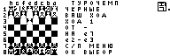

# Регрессия Flash VM: BASIC и FOCAL, Classic — 2026-10-17

Ветка **feature/flash-vm-perf**, база **36ff01c60**, код и тесты **c19c5f317**.

На одинаковом комплекте из 29 файлов Turochamp контрольный main не завершил
первый поиск за 600 с: 210 позиций на 597,096 с. Исправленный вариант
завершает первую компиляцию и поиск за **221.914 с**;
медиана трёх повторов — **59.542 с**.
Все шесть поисков дали e2-e3, 420 позиций и одинаковую полную доску.

## Причины и исправление

Каждый RUN безусловно выгружал уже загруженный нативный APP VM:
даже готовый образ языка заставлял повторно читать, проверять и распаковывать
исполнитель. На отдельной диагностической сборке за 40 секунд повторного
поиска зафиксировано 536 вызовов VM и 536 загрузок VM; время загрузки
составило 34,933 с включительно. Вложенные времена профиля перекрываются,
поэтому складывать их нельзя; они не входят в итоговый замер.

Готовый Flash-образ теперь получает рабочую область с сохранением APP.
Диспетчер проверяет тип и media revision исполнителя; смена на
компилятор/INPUT проходит обычную проверку. Холодная компиляция сохраняет
прежнее освобождение APP перед передачей памяти.

После переноса индекса и байткода в C9 каждый байт инструкции проходил через
resident callback, а чтения карты строк вытесняли единственную страницу.
Каждый RUN также заново искал Manifest, вычислял content stamp исходника
и идентичность языковых APP.

У LANGVM/LANGIN теперь собственное окно инструкций на **128 байт**,
действующее только в пределах вызова APP. Попадание opcode обращается прямо
к окну; операнды используют то же окно. Промах читает через resident
порциями до 256 байт. VM больше не загружает уже прочитанный opcode
вместе с операндами. Длинные IF, ON GOTO/GOSUB и SIMD сохраняют свои операнды.

Classic F411 использует ограниченный resident-кеш: **32 КиБ вместе
с метаданными**, 29 кадров по 1024 байта, 32 проверенных дескриптора
образов и два fingerprint языковых комплектов. Это ёмкости кеша:
переполнение вызывает вытеснение. Исходник, индекс и образ продолжают
читаться частями; целиком в RAM они не размещаются.
Остальные F411 сохраняют бюджет 24 КиБ; F401 и вариант resident VM — 0.
Окно инструкций на F401 остаётся.

Ключ страницы содержит полный 32-битный номер и каталог банка.
Любая смена C9 media revision инвалидирует страницы, дескрипторы
и fingerprint. Проверены изменения исходника/компилятора, внешние записи
и повторное использование inode. В resident-кеше нет указателей в APP.

Кеш выделяется перед запуском USB Screen, пока долговременные владельцы
не ограничили расширение heap. При нехватке памяти остаётся путь без кеша.
Команда prof показывает VMFLASH без выделения памяти и запуска профилировщика.

## Аппаратные результаты

Classic V3 UC1609, STM32F411CE 96 МГц, NOR EF3013 512 КиБ,
PublicID AEB505B6E0067623. Контрольная и исправленная сборки используют
GRID=1, USB Screen, resident-меню, просмотрщики и CHIP8,
внешний USBDISK, собственную compact_math. SHA всех 29 игровых файлов совпадают.

Книга выключена, уровень 2, максимальная глубина 8. Отсчёт — от OK при
выборе чёрных до завершённой доски со всеми восемью рядами. Подготовка файлов
и меню не входят в время поиска. Профилировщик остановлен; кадры USB
проверяются по CRC. Первый этап начинает с пустого файлового кеша.
Второй — после перезагрузки MCU с готовыми страницами в C9 и пустым RAM-кешем.

| Режим | Время поиска, с |
| --- | ---: |
| Первая компиляция | 221.914 |
| Повтор 1 | 59.542 |
| Повтор 2 | 59.576 |
| Повтор 3 | 59.488 |
| После MCU reset, страницы готовы | 59.627 |
| Следующий повтор | 59.534 |

Минимальный измеренный остаток стека — **8208 байт**;
MPU layout=ok, CRASH none. SHA полной доски одинаков во всех шести прогонах
(маскируется только значок дискеты 16×16).

Контрольная прошивка main **3DF44CE4** достигла 210 позиций на 597,096 с
и превысила таймаут 600 с. Времени полного поиска и прогретого повтора
для неё нет. Исторические 50,769/25,161 с в
chess-source-window-20261017.json относятся к другой конфигурации
и не используются для вычисления ускорения.

Промежуточное окно opcode на 256 байт дало 229,139/66,634 с.
Общий Reader на 256 байт сократил число callback ещё сильнее, но замедлил
поиск до 244,169/81,420 с из-за обработки каждого opcode через общий read.
Эти два эксперимента завершили по два корректных поиска; полная
квалификация из шести прогонов относится к выбранному окну 128 байт.

## Соответствие сборок и состояние Classic

Измерения выполнены с resident **3AB3DD45**, BIN 370064 байта,
и окончательными LANGVM/LANGIN. Нативная пересборка **7EAA3816** отличается
только четырьмя ASCII-символами времени сборки и восемью байтами CRC/build
в footer: исполняемый код и остальные данные побайтово одинаковы.
Прочитанный из Classic BIN совпадает с проверенным 3AB3DD45 по всему SHA-256.
Размер LANGVM — **20476**, LANGIN — **19180** байт в RAM;
потолок APP **20480 байт** сохранён. Максимальный foreground frame — 1928.

До итогового прогона dfu-util завис при перечислении USB в macOS.
Устройство возвращено в обычный режим адресным чтением и проверкой BIN,
затем штатной командой выхода DFU; записи внутренней Flash при этом не было.
Протокол: [ST AN3156](https://www.st.com/resource/en/application_note/cd00264379-usb-dfu-protocol-used-in-the-stm32-bootloader-stmicroelectronics.pdf).
Итоговая сессия не перепрошивала resident.

На Classic оставлен проверенный комплект 3AB3DD45 с новыми языковыми APP.
Только созданные сценарием /FLASHCHESS и /System/VMCache/Pages удалены.
Остальные исходные файлы, каталоги и состояние калькулятора проверены,
порт CDC закрыт. Pico и Mini не затрагивались. Исходный комплект сохранён
в локальном snapshot; восстановления старых System APP в итоговой сессии не было.

## Проверки

- ASan/UBSan: reference и shipping VM; образы больше 64 КиБ, переходы,
  FOR/IF/ON, DATA, INPUT со сменой APP, длинный текст, SIMD и ошибки I/O.
- Reader: 192000 побайтовых обращений и 1000 чтений операндов к одному окну
  требуют одного backing read; границы, хвост, нулевая длина и sticky I/O.
- Настоящий C9/NOR: 20 замен Store, по 16 чередований удалённых страниц.
  7540 физических чтений → 11, полностью прогретый повтор — 0;
  в измеряемом участке нет записей. Проверены все виды инвалидирования.
- Реальные ARM compiler/VM/INPUT APP: образы по 66225 байт, BASIC 4406 строк,
  FOCAL 4407, три адреса загрузки, INPUT/resume и отравление выгруженного APP.
  Callback-чтения BASIC: 366454 → 116317; FOCAL: 366483 → 116538.
  Это счётчики тестового адаптера, не время шахмат и не физические NOR-чтения.
- ARM USB start/allocator: кеш выделяется до долгоживущих буферов;
  IRQ/OOM, canary, повтор после освобождения, диагностика без аллокации.
- 20 paged transfer сохраняют APP и защитные значения при логическом образе
  200 КБ; холодный transfer выгружает APP и возвращает BUSY при закреплении.
- Полные языковые/SIMD/source/editor и overlay/resident handoff тесты.
- Native SDK, CDC RX, Flash/RAM/stack и APP gates на F411/F401.
  Членов libgcc/libm/libstdc++/libc/libnosys в линковке нет.
- F401: собран полный комплект **4EA42AD7**, BIN 231016 байт;
  физическое устройство не испытывалось.
- Альтернативное размещение VM в resident: BIN 400620 байт, кеш 0,
  effective APP pool 65760, frame 2784; проверена сборка, без аппаратного замера.

~~~sh
MK61_TEST_SANITIZERS=1 bash tests/run_app_flow_tests.sh
bash tests/run_language_flash_tests.sh
MK61_TEST_SANITIZERS=1 bash tests/run_program_store_tests.sh --language-flash
MK61_TEST_SANITIZERS=1 bash tests/run_language_vm_tests.sh
python3 tests/run_language_flash_arm_tests.py --resident-elf resident.elf --system-dir System
python3 tests/run_flash_vm_cache_usb_arm_tests.py --resident-elf resident.elf
python3 tests/check_native_runtime_libraries.py --without-libc resident.map
python3 tests/check_app_memory_elf.py resident.elf --system-dir System
~~~

Воспроизведение аппаратного сценария:

~~~sh
python3 tests/hil_flash_vm_chess.py \
  --candidate-bin resident.bin --candidate-system System \
  --restore-bin original.bin --output-dir /tmp/flash-chess-result \
  --runs 4 --ready-runs 2 --timeout 600 --menu-timeout 240
~~~

По умолчанию сценарий восстанавливает исходный комплект.
Итоговый замер выполнен с --keep-installed и --session-base после проверки
исходного snapshot, с последующей адресной очисткой своих файлов.
[Машиночитаемый отчёт, SHA и счётчики](chess-flash-page-cache-20261017.json).
