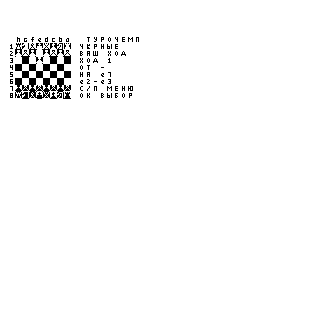

# PicoCalc Pico H: вход в целочисленный цикл, 19 октября 2026

Итоговая **0.8.5 / CF0C90F4**: прогретый повтор того же первого хода —
**23.335 с**, сокращение времени на **6.8%**
относительно повторного контроля 0.8.4. Первый запуск после прошивки —
**29.545 с** против **31.188 с** у контроля.

| Вариант | Первый после прошивки, с | Прогретые повторы, с |
| --- | ---: | ---: |
| Контроль 0.8.4, возвращён после экспериментов | 31.188 | 25.032 |
| Ранний вход в integer_span | 29.913 | 23.352; 23.181 |
| Только упрощённое форматирование отчётов | 31.903 | 25.312 |
| Ранний вход и декодер в SRAM | 29.773 | 23.206; 23.077 |
| Итоговая 0.8.5: ранний вход | 29.545 | 23.430; 23.239 |

Контроль установленной 0.8.4 в начале сессии дал 25.817 и 25.027 с.
В конце экспериментов та же исходная UF2 5634B604 снова прошита и измерена.
Все варианты используют одну базу `83ee643fa0c91b04aaacc292c385922c69e184fb` и прежнюю
IEEE-арифметику owned-M0. Незавершённые изменения математики соседнего чата
исключены из сохранённого снимка.

Каждый запуск считает один первый ход **e2–e3**, 420 просмотренных позиций,
уровень 2, максимальная глубина 8, дебютная книга выключена. Все восемь
рядов доски и полный упорядоченный поток 7721 отчёта модулей после двух
входных/меню-модулей совпали с контролем. Последний STOPPED — намеренная
остановка сценария после законченного хода. Все 29 файлов игры перечитаны
до и после контрольной и финальной серий и совпадают байт в байт.

Частота — 125 МГц. Итоговые замеры без профилировщика. Отсчёт — от OK
на выборе чёрных до полного CRC-проверенного кадра доски; меню исключено.
Первый после прошивки не означает пустой SD-кеш: игровые кеши сохранены.

## Профиль и изменение

Отдельный профиль 0.8.4 показал примерно **17.2%** PC-выборок внутри
integer_span и **9.5%** в диспетчере run. Декодер занимал около 1.4%,
скомпилированные короткие блоки — 1.5%, общий vsnprintf — 3.0%.
Всего 30179 выборок, 489 потеряно.
Это оценки по 64-байтным корзинам с пересечениями символов. Диагностический
запуск включает меню; вложенные включительные области не складываются.

Существующий integer_span уже поддерживал LOAD, INTEGER_SHORT и
LOAD_ARRAY_FIXED, но диспетчер начинал его для более узкого набора команд.
Теперь на Pico он пробует эти три входа до общего декодера. Целочисленная
цепочка дольше остаётся внутри быстрого цикла в SRAM. Сохраняются проверки
типов/границ/переполнения, исходные операции и неактивные ячейки стека,
общие банки, счётчик шагов, продолжения INPUT и опрос каждые 32 инструкции.
При отказе проверки продолжает работать прежний скалярный вычислитель.
Bytecode и ABI приложений сохранены.

Упрощённое форматирование отчётов не дало выигрыша и отклонено; все
VM_RESULT сохраняют прежний формат и вывод. Размещение декодера в SRAM
улучшило медиану отдельного опыта лишь примерно на 0.125 с относительно
раннего входа — близко к разбросу этой серии. Оно также отклонено, с
экономией 224 байт SRAM относительно этого прототипа.

Условие MK61_CORE_STANDALONE && PICO_ON_DEVICE ограничивает изменение Pico.
Статическая область — **195056 / 229376 байт**,
начальный heap — **34320 байт**;
это на 32 байта меньше статического SRAM, чем у 0.8.4. Основной стек 32 КиБ
и стек второго ядра 2 КиБ зарезервированы отдельно.

## Проверки

Полный host-набор Pico прошёл ASan/UBSan с включённым новым путём.
Отдельный скалярный эталон дал 4 × 141278 точных сравнений: оба
математических режима, трассировка и прямой путь без неё. Проверяются
шаги, ошибки, опросы, неактивные ячейки, общие/перекрывающиеся банки,
границы, INPUT/ESC и продолжения.

На точной итоговой UF2 проверены нативные 320×320 и прежние 192×64 APP,
эталон пикселей и CRC передаваемого в LCD потока, BASIC/M61/Markdown,
настройки/сброс, RAM/SD-кеш с изменением исходника и USB-сон/пробуждение.
Все семь приложений комплекта и два документа SHEET перечитаны с microSD
и запущены. Регистры, пять значений стека, программа и каталог восстановлены
и перечитаны. Тестовые файлы удалены. Проверка питания — через USB.

STM32 F401 product A00 и F411 Classic V3 собраны из финального снимка
с прежними ограничениями стека, Flash и RAM. M4 LANGVM занимает
20412 из 20480 байт и побайтно совпадает с 0.8.4;
runtime-архивы прошли прежний gate. STM32 не перепрошивались.

SHA-256 UF2: `c3c59cfdb85b8d9d59039b8ff4c5466437db4349b2c1eb1559e04fc4ed2dfa8b`.

[Точные результаты и протоколы](chess-picocalc-span-entry-20261019.json).
