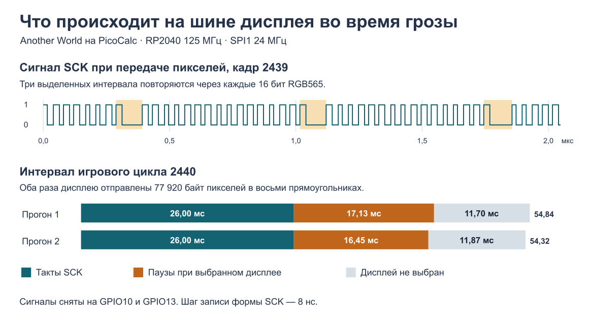

# Another World на PicoCalc. Паузы SPI во время грозы

Четыре прогона на RP2040 при 125 МГц и SPI1 при 24 МГц показали, что цепочка DMA периодически исчерпывает готовые полосы пикселей. В двух прогонах кадра 2440 непосредственно зафиксировано 69 и 61 такое положение. В каждом передача остановилась на границе трёх строк. Прошивка платы имела BUILD `02ED8BDF`, CRC `338ACCB0`. [Первый журнал DMA](feed-1.txt) · [Второй журнал DMA](feed-2.txt)



## Что заняло время в интервале 2440

Игра подала 77 920 байт RGB565 в восьми прямоугольниках. В обоих прогонах на GPIO10 зарегистрировано 624 064 импульса SCK, включая 704 такта команд и параметров восьми окон. Интервал ограничен двумя соседними вызовами игрового планировщика. Асинхронная передача может пересекать его границу.

| Измерение | Прогон 1 | Прогон 2 |
|---|---:|---:|
| Весь игровой интервал | 54,84 мс | 54,32 мс |
| Число импульсов, делённое на 24 МГц | 26,00 мс | 26,00 мс |
| Дополнительное время с активным CS | 17,13 мс | 16,45 мс |
| Время с неактивным CS | 11,70 мс | 11,87 мс |
| Паузы SCK при активном CS длительнее примерно 0,5 мкс | 129 | 138 |

Два PIO-счётчика измеряли спады SCK и время активного CS на GPIO13. Два других считали длинные паузы и записывали короткие серии уровней сигнала с шагом 8 нс. Чтение счётчиков занимало до 1 мкс на границе интервала, суммарно 41 и 44 мкс за 67 интервалов. Время с неактивным CS включает запланированное ожидание следующего кадра. В интервале 2415 зарегистрировано всего 24 командных такта, а в 2416 отправлен полный экран из 128 000 байт. Там одни такты заняли 42,68 мс при бюджете 40 мс для 25 кадров/с. [Программа PIO](../../../tests/another_world_spi/wire.pio) · [Первый журнал PIO](scope-1.txt) · [Второй журнал PIO](scope-2.txt) · [Все 134 интервала](frames.csv)

### Калибровка

В восьми контрольных передачах по 5120 пикселей счётчик каждый раз увидел 82 008 тактов. Из них 81 920 приходятся на пиксели и 88 на команды и параметры. Для прямоугольника 320 × 16 первый контроль на каждой частоте занял 8,75 и 8,93 мс при 12 МГц, 4,91 и 4,99 мс при 24 МГц. Регистры подтвердили 16-битный DMA, TX-канал 6 с DREQ 18 и RX-канал 7 с DREQ 19. У TX увеличивался адрес источника, у обеих сторон адрес SPI1_DR был фиксирован.

Внутри слова восходящие фронты разделены 5–6 тактами CPU. Между соседними словами RGB565 интервал увеличивается до 13–14 тактов, что видно и в настоящих цветных обновлениях 2406, 2439 и 2441. Это примерно 62,5 нс дополнительного времени на слово при 24 МГц. В кадре 2440 получается около 2,44 мс на 38 960 пикселей. Остальные 14,01–14,70 мс с активным CS включают команды, подготовку первых полос и остановки внутри потока. [Осциллограмма](spi-storm.png) · [Руководство Arm PL022, рис. 2-5](https://documentation-service.arm.com/static/5e8e3bc7fd977155116a9361)

### Где останавливается DMA

Во второй паре прогонов AWFEED читал регистры во время передачи пикселей. Он проверял активный CS, режим данных D/C, 16-битное слово, пустой TX FIFO и свободный сдвиговый регистр. TX и управляющий DMA были остановлены. RX оставался активным с неизменным ненулевым остатком уже начатого окна. Повторные наблюдения той же позиции одного окна учитывались один раз.

| Интервал | Различных остановок в двух прогонах | Подтверждённое время ожидания |
|---|---:|---:|
| 2439 | 77 / 76 | ≥3,66 / ≥3,20 мс |
| 2440 | 69 / 61 | ≥3,38 / ≥2,76 мс |
| 2441 | 36 / 30 | ≥1,77 / ≥1,95 мс |

Во всех 130 пойманных остановках кадра 2440 адрес источника TX равнялся нулю. Так драйвер помечает следующий неподготовленный дескриптор. Остаток RX показал, что DMA дошёл ровно до границы трёхстрочной полосы. Нижняя граница времени учитывает только промежутки между двумя наблюдениями одной остановки. [Проба DMA](../../../tests/another_world_spi/feed.h) · [Публикация дескриптора и перезапуск цепочки](../../../ports/picocalc/hardware.cpp)

Два буфера драйвера вмещают по 960 пикселей. По геометрии восьми прямоугольников кадра 2440 нынешняя нарезка требует 147 полос. Расчёт даёт 56, если в каждом прямоугольнике оставить первые две полосы по три строки, а затем брать до ⌊960 / ширина⌋ строк. При заполнении с первой полосы получается 44. Выигрыш в миллисекундах для обоих вариантов ещё предстоит измерить. [Геометрия кадров](rectangles.csv) · [Буферы и дескрипторы](../../../ports/picocalc/lcd_chain.hpp)

## Воспроизведение

Проверка сохранённых журналов выполняется из корня репозитория и требует только Python.

```sh
python3 tests/another_world_spi/replay.py
```

Параметр `--csv FILE` сохраняет покадровые результаты. Для пересборки диагностических APP нужны Arm GNU Toolchain и `pioasm` из Pico SDK. Опциональный параметр `--check-data` запускает на компьютере оба варианта и проверяет все 67 отображённых кадров попиксельно. Для этого нужны C/C++ с ASan/UBSan и локальная папка установленной DOS-игры с AWSTORM.BIN. Пути к инструментам можно передать через `--toolchain` и `--pioasm`.

```sh
python3 tests/another_world_spi/build.py
python3 tests/another_world_spi/build.py --check-data "/path/to/Games/Another World"
```

На PicoCalc каждый диагностический APP запускается из каталога игры и сам завершает прогон после сцены. Для получения журналов использован USB-терминал, команда `open "/Games/Another World/AWSCOPE.APP"` или `open "/Games/Another World/AWFEED.APP"`. До кадра 2350 диагностика ускоренно исполняет VM и микшер, затем включает обычный вывод. Контрольный хеш первого изображения — `4FC268F0`. В каждом прогоне счётчик пропусков PCM за измеряемый отрезок остался нулевым.

| Файл | SHA-256 на испытаниях |
|---|---|
| AWSCOPE.APP | `582183995545a6a243eb6f0ff82d3bdfcfb28298107b0f984aec9de8d7d93f55` |
| AWFEED.APP | `081fe4fa0c8eb038b18fe83921219f454d97fd6201d2898e42cbd97691777fe2` |
| Штатная ANOTHER.APP | `0bab339977b20ac91c7c84381a59304afcdc6807090cb0386c64ed63293d6f25` |
| AWSTORM.BIN | `a7342091834d5eb70de673e89fde987790a939a024c25db4e7f67f85554d59e1` |

Обе диагностические APP собраны xPack Arm GNU Toolchain 14.2.1. Контрольные суммы штатной игры и кеша совпали до и после испытаний.
