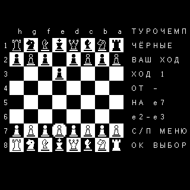

# PicoCalc: крупный шахматный шрифт, 19 октября 2026

**0.8.7 / A270FF58**: текстовые ячейки 12×24, шахматные клетки 24×24,
сетка 26×10 на родном экране 320×320. Буквы используют готовый пиксельный
Ark Pixel 12px без масштабирования; шахматные фигуры нарисованы отдельно.
Два соседних глифа составляют квадратную клетку. Заголовок, все восемь
рядов и боковые подписи помещаются одновременно.

BASIC-часть `display.tbi` проверяет `GW>=320 AND GH>=320` и возвращает
выбор через `.RE`. M61 загружает `Turochamp320.FMK`, а при его отсутствии
или ошибке — прежний `Turochamp.FMK`. Компактный файл 7×7 побайтно сохранён.
Отображение пар глифов включается только при фактически выбранных
26 столбцах и `GH>=320`. Поэтому отсутствие крупного файла сохраняет
прежние доску и подписи. На STM32 остаётся компактный вариант.

Крупные текстовые FMK на PicoCalc рассчитывают сетку по 320×320 и
центрируются; компактные FMK сохраняют сетку 192×64. В обоих случаях
LCD получает пиксели исходного шрифта. Старые USB Screen клиенты видят
обрезанный совместимый растр; клиенты 320×320 получают весь кадр.

Крупный файл занимает 7466 байт. Прежний буфер загрузки — 8192 байта;
статическая RAM остаётся 194640 из 229376 байт, начальный heap — 34736.
Flash — 692456 байт, на 248 больше 0.8.6. Математика и частота 125 МГц
сохранены; параллельные незавершённые изменения математики исключены из
исходного снимка. Базовый коммит — `3f2d53856`.

## Проверки

Pico host-набор прошёл ASan/UBSan, включая фактический запуск игры с
крупным шрифтом и повтор при отсутствии его файла. Все 64 исходные
клетки, цифры рядов и границы поля сверены с декодированными FMK-пикселями.
Компактный вариант прошёл правила, perft, превращения, рокировку,
взятие на проходе, отмену, повторения, оценку, поиск, клавиатуру,
доску и дебютную книгу на интерпретаторе и VM. Прошли проверки FMK,
сгенерированных файлов, лимитов исходников/строк и контрольных сумм ZIP.

STM32 F401 product A00 и F411 Classic V3 собраны из чистого снимка с
прежними проверками стека и памяти. Прошивки STM32 не устанавливались.

На PicoCalc проверены точный UID, CRC прошивки, MATH_TEST и отсутствие
крашей. На microSD обновлены пять файлов, прежние версии сохранены
локально; все 31 файл игры перечитан после обновления перед серией.
Повторного чтения всех исходников после серии не было.

Два запуска одного первого хода e2–e3, с выключенной книгой, уровнем 2
и максимальной глубиной 8, дали по 420 позиций:

| Запуск | Время, с |
| --- | ---: |
| Первый после прошивки и обновления файлов | 29.091 |
| Прогретый повтор | 22.967 |

Отсчёт — от OK на выборе чёрных до CRC-проверенного полного кадра доски;
во время поиска USB Screen отключён и подключается по готовому текстовому
результату. Меню и последующая проверка физической передачи не входят
в интервал. Все 64 клетки и восемь цифр рядов сверены в обоих кадрах.
Независимая конвертация в горизонтальный MSB-растр дала CRC A2944C6F;
оба завершённых LCD-переноса имеют тот же CRC.

Прежний отчёт 0.8.6 с компактным шрифтом дал 21.997 с на прогретом повторе.
Это сравнение разных сессий, а не одновременный A/B-контроль: новый экран
печатает вдвое больше глифов доски и больше пикселей. Поиск и оценка не
менялись. Регистры, пять значений стека, программа и каталог восстановлены
и перечитаны. Проверка выполнена от USB, без аккумуляторов.

Полный пакет содержит `games/Turochamp/` и лицензию Ark Pixel в
`licenses/ui-fonts/LICENSE-Ark-Pixel.txt`. Для новой игры папка и прошивка
обновляются вместе: крупный шрифт требует рендера 0.8.7.

[Точные результаты](picocalc-chess-large-font-20261019.json).
