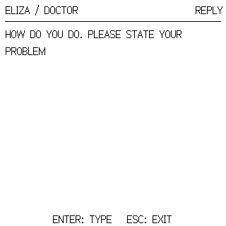

# ELIZA: крупный шрифт PicoCalc, 20 октября 2026

Проверено на Pico H `E6657CD423721C35`, прошивка **0.8.8 / C572E6CF**.
На microSD обновлён `/MK61S-PicoCalc-0.8/ELIZA.APP`, а также контрольные
суммы этой записи в manifest.json и INSTALL.json. Прошивка не менялась.

Подсказки, ввод и ответы используют один родной Ark Pixel 16px.
APP рисует глифы 1:1 в заимствованном буфере 320×320. Область текста —
304 пикселя и 11 строк с шагом 24. Переносы считают реальную ширину букв;
длинное слово переносится по символам, длинный ответ — на следующие страницы.
Курсор остаётся виден при вводе до 511 байт. Текст редактирует прежняя служба
редактора: QWERTY, SMS, Backspace и стрелки. Сохранённые настройки шрифта
калькулятора APP не меняет.

Аппаратно проверены обе подсказки, ввод `hello` с исправлением Backspace,
движение курсора влево и вправо, полный ответ DOCTOR, строка из 511 байт
с широкими W и её прокрутка, все пиксели ответа на двух страницах, прощание,
Esc и повторный запуск. Принято 109 кадров USB Screen с CRC.
Пиксели сверяет отдельный Python-компоновщик из исходного Ark JSON;
CRC снимка для LCD совпал на каждой странице длинного ответа. Это не чтение GRAM.
Регистры, пять значений стека, программа, текущий каталог, настройки шрифта
и режим USB Screen после серии восстановлены.

Вся новая презентация компилируется только для native PicoCalc.
Контрольные APP для STM32, собранные одинаковым компилятором и параметрами
до и после изменения, **побайтно идентичны**, SHA-256:
`ec1ffc0ecc30b556a40484735f6a27cc23da3e3b7417b6b77c553edb01445b53`.
Существующий `programs/app/ELIZA.APP` не заменялся. Из комплекта Pico H
изменён только ELIZA; остальные шесть APP сохранены побайтно.

Проверки точного DOCTOR, старого Classic UI и нового Pico UI прошли с
ASan/UBSan. Хост также проверил 1151-байтовый ответ, длинное слово,
прокрутку и положение курсора в начале, середине и конце 511-байтового ввода.
Новый APP занимает 16800 байт своего региона вместо 15668; кадр 12800 байт
принадлежит resident и не добавляется к BSS приложения.

[Точные результаты](picocalc-eliza-large-font-20261020.json).
