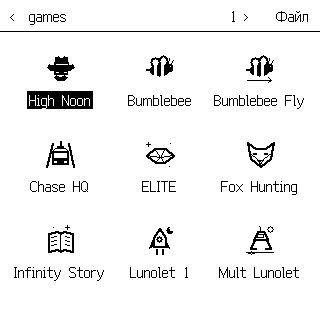

# Проводник и значки PicoCalc — 3 ноября 2026

Новый Проводник проверен на Pico H `E6657CD423721C35`: прошивка **0.8.16 / 88BD99FF** оставлена на устройстве. На существующую microSD добавлены 18 значков, каждый файл проверен чтением. Старые данные пользователь разрешил не восстанавливать; для проверки использованы X=42, Y=17, R0=123.25 и текущие московские часы.

## Интерфейс и ресурсы

PicoCalc рисует девять значков 32×32 на родном экране 320×320. Выделяется только подпись; заголовок, тонкие разделители и минимум служебной графики сохраняют место для файлов. F8 переключает значки и список. Меню файла позволяет войти в папку, не выполняя её `autoexec`.

Общий растеризатор поддерживает Classic 192×64: три значка или пять строк списка. Символьные экраны и конфигурации без графического Проводника сохраняют текстовый вид. Ресурсы выделяются на время работы и освобождаются при выходе.

Добавлены 27 оригинальных рисунков для всех 23 исходных папок `programs/` и создаваемых сборщиками папок приложений, System, кеша и лицензий. Это WBMP Type 0 размером 132 байта, без масштабирования и сглаживания. Pico-комплект содержит 22 таких папки. Python, PowerShell, Arduino и установщики System включают нужные значки и проверяют их чтением; старый пакет без значков не удаляет уже установленные изображения.

## Аппаратная проверка

`tests/hil_picocalc_explorer.py` проверил:

- точные пиксели штатного шахматного значка, родной растр и выделение только подписи;
- меню файла и вход в папку без исполнения сценария;
- переход между страницами, поиск, переключение список/значки;
- пустую папку и возврат из запроса нового имени.

Для всех девяти контрольных кадров CRC совпала с завершённым LCD-кадром. CRC относится к переданному буферу, не к оптическому считыванию панели. Отдельно сохранён приведённый выше кадр реальной папки `/games` после установки значков.

Первый прогон предыдущей сборки **875904AA** выявил дефект: когда два постоянных кеша занимают всю PSRAM, необязательный кеш значков не выделялся, и Проводник показывал стандартные папки. Исправление использует проверенное временное выделение 1152 байт SRAM, если PSRAM недоступна. Доли VM/SD не менялись. Регрессионный тест занимает внешнюю память невытесняемым буфером и проверяет точные пиксели, обновление, листание и освобождение SRAM.

| Режим | Временная SRAM | Занято PSRAM | Кеш VM | Кеш SD |
| --- | ---: | ---: | ---: | ---: |
| Значки | 3528 | 8388608 / 8388608 | 4194304 | 4194304 |
| Список | 2376 | 8388608 / 8388608 | 4194304 | 4194304 |
| После выхода | 0 | 8388608 / 8388608 | 4194304 | 4194304 |

Физического ввода во время автоматического прогона не было. Тестовые регистры, стек, программа и каталог совпали до и после проверки; временная папка удалена. Итог: `CRASH=NONE`, CRC прошивки корректна, ошибок LCD/DMA нет, калькулятор открыт, USB Screen выключен, порты закрыты. Settings journal побайтно совпал до и после загрузки прошивки.

Установлены 18 отсутствовавших `autoexec.wbmp`. Папок `/games/Runner`, `/apps`, `/licenses` и `/licenses/ui-fonts` на карте нет: они пропущены без создания пустых каталогов. Пользовательских конфликтующих значков не найдено. Игры, приложения и шрифты этим шагом не перезаписывались.

## Совместимость и воспроизводимость

Пройдены Pico host tests с ASan/UBSan, регрессия заполненной PSRAM, тесты Classic resident/APP с графическим и текстовым интерфейсом, проверка ресурсов, каталога System, установщиков CDC и Arduino, сборщики System на Python и PowerShell, упаковщик Pico с проверкой ARMv6-M и CRC. Воспроизводимость native game-artwork проверена `--check-inputs`; 15 картинок прошли производственные декодеры. Математика не менялась.

Сохранены ранее пройденные контрольные сборки STM32 этого изменения: Mini F401 A00 — 222832 байта, Classic F401 — 258028 байт, Classic F411 — 398736 байт. Их точные хеши и база сборки находятся в архиве `candidate-builds.json`. Финальный firmware-код Pico содержит актуальный main `92a0ff0f4d333f3c23af89b12ea60b2be1b2d0c4`; после этих независимых исправлений повторены Pico suite и проверка упаковки. Эти проверки сборки не заменяют испытания на физическом STM32.

- UF2 SHA-256: `4577bd3f9a0cefc409dc9e38e25f69d54461d3a02b225f9bfc327dad821e6651`.
- BIN SHA-256: `dbc3f11c29d39c4c8a02a3746f4ee560bb948090b5693ccc0778fcc0aa4f924e`.
- Исходники firmware SHA-256: `3487eb018b05acd31bd1437f6bd97d464c5005abbb499bca4c4775d7d7fd30e1`.
- Integrity CRC32: `9B32EFA4`, footer 748096, образ 1537056 байт.
- Статическая RAM: 124748 байт; data+bss: 81828 байт; резерв стека: 32768 байт.
- Проверенный firmware-код: `191f7d25bf6a7314b0eaa91b3e7e0f7815cfd6c4`; последующая фиксация отчёта не меняет этот fingerprint.

[Машиночитаемый отчёт](picocalc-explorer-20261103.json) содержит хеши кадров и исходных аппаратных отчётов. Полные логи, точные копии прошивок, архив прежнего Flash и settings сохранены вне удаляемого worktree в `.build/picocalc-explorer-final-20261103-001/`; `RELOCATION-MAP.json` связывает прежние пути с сохранёнными. Семь посторонних изменений primary (`.gitignore` и Ms research) в эту работу не входят.
