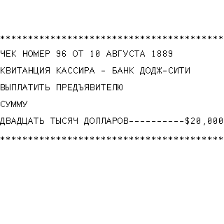

# High Noon на PicoCalc, 20 октября 2026

Проверено на Pico H `E6657CD423721C35`, прошивка **0.8.8 / C572E6CF**.
Для адаптации обновлены только файлы игры: новая прошивка не нужна.
На microSD установлен полный пакет из девяти файлов в `/games/High Noon`.
Все файлы прочитаны обратно побайтно до и после игры.

`display.tbi` проверяет GW/GH до загрузки шрифта. Для 320×320 M61 выбирает
`HighNoon320.FMK`: 40×10 ячеек 8×24, с родными пикселями Ark Pixel 12px.
Семь широких русских букв вписаны отдельно, справа у всех глифов остаётся
пустой столбец. Масштабирования нет. На STM32 выбирается прежний компактный
`HighNoon.FMK`, сохранённый побайтно. При отсутствии крупного файла
предусмотрен возврат к компактному шрифту. Лицензия Ark Pixel приложена
в комплекте в `licenses/ui-fonts/LICENSE-Ark-Pixel.txt`.

Для 40 столбцов разделена одна длинная строка инструкции. В чеке сохранён
прежний расчёт для пропорционального шрифта UC1609; новый вариант использует
десять дефисов, и `$20,000` заканчивается ровно у правого края строки.

Аппаратный тест прошёл инструкцию, меню ходов, неверные ответы, движение
игрока и Барта, сдачу, бегство, Esc при вводе, естественную победу и награду.
RNG не подменялся. Победа: дуэль 3, ход 9,
выстрелов 2. Проверены все семь строк чека по настоящим
FMK-пикселям: обе рамки, номер, дата, банк, получатель, сумма словами и
`$20,000`; в этом запуске чек №96 от 10 августа 1889.
CRC исходного снимка LCD совпал с кадром USB Screen; это не чтение GRAM.
Всего принято 795 кадров с проверкой CRC. После завершения
восстановлены регистры, пять значений стека, программа, текущий каталог
и режим USB Screen; прежний шрифт возвращается при штатном выходе и Esc.

На хосте прошли PicoCalc M61 и проверка чека с ASan/UBSan, TinyBASIC/VM,
все профили шрифтов и 24624 сценария эквивалентности игровых правил.
Прошивки STM32 при изменении игровых ресурсов не пересобирались.

[Точные результаты](picocalc-high-noon-20261020.json).
