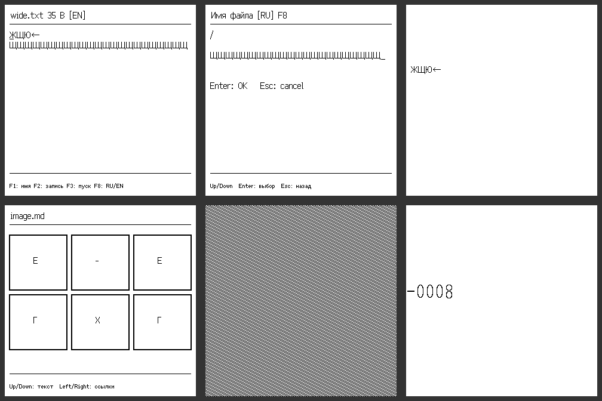

# PicoCalc: завершение адаптации 320×320, 20 октября 2026

Все оставшиеся пункты аудита адаптации выполнены. Прошивка **0.8.9 / FF3AD635** установлена на Pico H `E6657CD423721C35`. Полная аппаратная проверка прошла; карта обновлена и проверена чтением. Регистры, стек, программа и текущий каталог восстановлены.

## Изменения

- Редактор, имена файлов и консоль BASIC/FOCAL используют родной Ark Pixel 16, ширину глифов и прокрутку в пикселях. Широкие русские буквы, стрелки и курсор не обрезаются.
- Встроенные профили M61 используют родные шрифты: обычный 20×10, плотный 32×10, крупный 20×10. Пользовательские FMK сохраняют свою геометрию.
- Обычный текст и пропорциональные строки APP вмещают полные глифы. Старые APP 192×64 сохраняют старые размеры и метрики службы шрифтов.
- `PRINT AT` BASIC/FOCAL рисует Ark/FMK непосредственно в кадр; продолжение печати учитывает высоту строки. STM32 сохраняет прежний растеризатор 5×8. Графические примеры учитывают крупные подписи.
- Часы, альтернативный индикатор и интерфейсный моноширинный шрифт рисуются родными глифами.
- Markdown и Проводник выбирают соседние `*-320.wbmp`, сохраняя все 320 столбцов изображения. Добавлены 15 иллюстраций; компактные WBMP сохранены побайтно. Векторные рисунки растеризованы заново, подписи используют исходные пиксели Ark; сканы только уменьшены, без увеличения.
- «Шмель» получил FMK 16×32 и атомарное рисование спрайта; дополнительный BASIC-запускатель необязателен, компактный запуск проверен отдельно. WBMP.APP понимает физические Up/Down PicoCalc и ограничивает последнюю страницу.

## Проверка устройства

Выполнены 11 сценариев:

1. idle clock uses the exact native Ark strike, right aligned in the title row
2. real legacy M0 APP: 192x64, four 16px rows, 10x16 glyph/12px advance and public font service agree pixel-for-pixel
3. alternate calculator digits and Ark Mono interface use native strikes; selected indicator font restored
4. native APP: wide Cyrillic/arrows, 19-column fixed cells, editor horizontal scroll/cursor, proportional row 12; exact pixels and DMA CRC
5. M61 default native 20x10 geometry, centred Ark strike and intact wide glyphs
6. BASIC and FOCAL PRINT AT: identical full native glyphs at pixel coordinates, independent Ark oracle
7. built-in editor and UTF-8 filename prompt: full wide glyphs, pixel-based horizontal scrolling and visible insertion cursor
8. Markdown and Explorer automatically select native WBMP sibling, all 320 columns preserved pixel-for-pixel
9. real WBMP.APP FILE_OPEN: Pico Down/Up page scrolling, bottom clamp and byte-exact return to first page
10. Bumblebee native 16x32 FMK, sprite at middle row with exact glyph pixels
11. actual Bumblebee autoexec: manual, optional BASIC geometry bootstrap, native trap handlers and live ROM-driven animation

Проверены 20 статических кадров и живой ROM-цикл «Шмеля». Сравнение с независимыми глифами/пикселями и CRC завершённого DMA-кадра выполнено на работающем RP2040. CRC относится к буферу, переданному LCD; это не оптическое считывание панели.

Сбоев не зарегистрировано, CRC установленной прошивки корректна. Временные файлы HIL удалены. На microSD проверены **132 файла**, **110 обновлены**; остальные уже совпадали. В комплекте семь APP и все 15 игр. Установленные файлы дополнительно сверены с финальным комплектом по SHA-256.

## STM32 и автоматические проверки

| Профиль | Flash | Глобальная RAM | Максимальный кадр стека | Результат |
| --- | ---: | ---: | ---: | --- |
| Classic F411, USB Screen | 378456 / 524288 | 21752 | 1928 / 5120 | PASS |
| Mini F401 | 232004 / 262144 | 27292 | 1304 / 2048 | PASS |

Контрольные сборки используют HEAD `9800654d238e19ba61fb3e796de6ca4f5729acb2` с этими изменениями общего кода. Они не заменяют проверку на физическом STM32. WBMP.APP Classic до и после изменения совпадает побайтно: `306c4bc48572a4bf29e5af14d0e5d184d89cc6edda9afbdc7d52230ba41301ae`.

Общий PicoCalc suite и графика BASIC прошли ASan/UBSan; также прошли M61, FOCAL, Markdown, WBMP, производственные декодеры всех новых картинок/FMK, проверка воспроизводимости ресурсов и упаковщик с отказом при устаревших доказательствах. Логи и их SHA-256 перечислены в [машиночитаемом отчёте](picocalc-native-complete-20261020.json).

## Воспроизводимость

- UF2 SHA-256: `5d156bcd306a4835b9514f90066f04b8a5b5f6d7ff131541a4b564ba94c43ee4`.
- Исходники прошивки SHA-256: `6ee35d15aadda88c28a99d7a970f9106d6d8fb4414357b8fdf92e937cf77296f`; проверены после HIL.
- Flash: 713280 байт; статическая RAM по manifest: 194964 байт; стек зарезервирован 32768 байт.
- Pico WBMP.APP SHA-256: `d49e9597da2e503f82ad3283e82a904089b115a1d692ee2c8a11f9d310cd62db`.
- ZIP `mk61s-picocalc-pico-h-0.8.9.zip`: `ec8947f944daa18a723e4d6391c196166bb29c36f9163bd7cdc1b6bd2933b4b2`.

Прошивка собрана из принятой базы `c2730fe57a0bd91b0363d5a4eb14fd2a6bd4edec` с этими UI-изменениями и прежней принятой математикой C572E6CF. Параллельные экспериментальные изменения математики Cortex-M0+ в неё не включены. Точный каталог исходников и хеши свидетельств указаны в JSON. Существующий проверенный комплект восстановления 0.8.8 сохранён, для 0.8.9 создан отдельный комплект.
