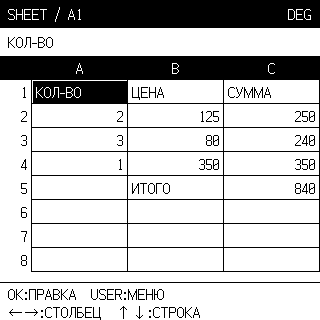

# Таблицы: родной экран PicoCalc, 20 октября 2026

Проверено на Pico H `E6657CD423721C35`, прошивка **0.8.8 / C572E6CF**.
На microSD обновлён `/MK61S-PicoCalc-0.8/SHEET.APP` и контрольные суммы
этой записи в manifest.json / INSTALL.json. Прошивка не менялась.

Сетка, редактор, меню, детали и справка используют физические координаты
320×320. Обычный вид — **3×8** ячеек родным Ark Pixel **16px**, обзор —
**4×11** родным **12px**. Масштабирования нет. Ширина чисел, подписей и
переносов считается по метрикам глифов. Длинная подпись заканчивается `>`
внутри ячейки; полный источник до 95 байт и курсор доступны в редакторе.
Переключение плотности у P32 удерживает сетку в границах A1:P32.
В Pico APP нормализованы Tab (USER) и ↑/↓ старого resident ABI 6;
доступны меню, ссылки, вертикальное перемещение и начало/конец черновика.

Аппаратная серия сверила полные 320×320 кадры с независимым компоновщиком
на Python из исходного Ark JSON: обычный вид, обзор, P32 в обоих режимах,
документ после сохранения/повторного открытия, прежние BUDGET и CYCLE.
Проверены формула и её результат, фиксированная ссылка, подпись из 95
широких русских букв, курсор/удаление, меню из восьми пунктов, детали,
обе страницы справки и подтверждение сохранения. `.mks` прочитан обратно:
источники, плотность и CRC корректны. Временный файл удалён; BUDGET/CYCLE
сохранены побайтно. Принято 238 USB Screen кадров с CRC.
CRC снимка источника LCD совпал на проверенных сетках; GRAM панели не читался.

Регистры, X/Y/Z/T/LAST X, программа, каталог, настройки шрифта и USB Screen
после серии восстановлены. Кадр 12800 байт заимствуется у resident, отдельно
в APP не выделяется. APP занимает 22128 байт вместо 21640.

Все новые функции рисования компилируются только для PicoCalc. Формат S1,
вычислитель и команды редактирования общие с Classic. Контрольные APP STM32
до и после, собранные одинаковыми параметрами и GCC 14.2.1, **побайтно
идентичны**, SHA-256 `096cb5429946f3fbc359d7bc3058fdc2a7ead890a5bddaf774b6de89e16b1571`.
Существующий `programs/app/SHEET.APP` не изменён. Остальные шесть Pico APP
сохранены побайтно. Хостовые проверки вычислителя, ввода, UI Classic/Mini и
Pico прошли с ASan/UBSan; проверена также упаковка и отклонение устаревшего
аппаратного отчёта для другого SHA-256 приложения.

[Точные результаты](picocalc-sheet-native-20261020.json).
