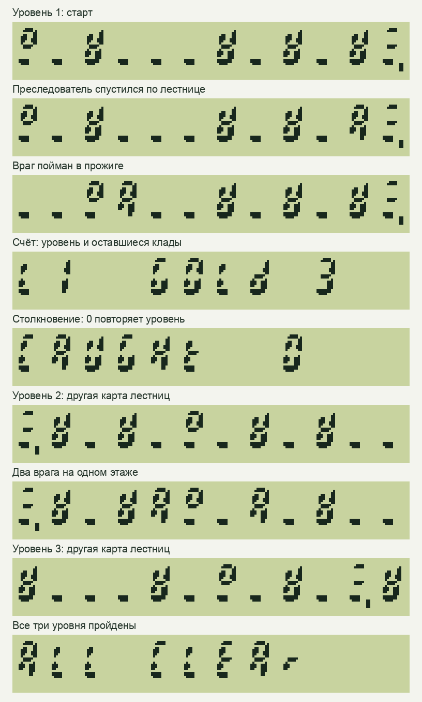

# Runner: полная игра

Исторический снимок до установки 28FBFF7A. Последующие изменения и реальные
замеры описаны в [отчёте завершения](runner-finish-20261030.md).

30.10.2026. Реализованы пять оставшихся частей: враги, поражение и повтор,
клады со счётом и победой, три уровня, баланс и оптимизация исполнения.

| Часть | Поведение |
| --- | --- |
| Враги | Самостоятельно преследуют героя по этажам и лестницам; попав в прожиг, ждут восстановления и возвращаются к месту старта |
| Поражение | Контакт показывает `CAUGHt 0`; направления больше не двигают героя; 0 повторяет текущий уровень |
| Клады | По три на каждом уровне; повторное посещение не увеличивает счёт; 5 показывает номер уровня и остаток |
| Кампания | Три разные карты; последний клад переводит дальше, после третьей — `ALL CLEAr`; 0 начинает новую кампанию |
| Баланс и скорость | Проверены обычные и размеренные прохождения; поиск пути заменён таблицами, кадр публикуется атомарно |

На первом уровне один враг с периодом 2000 мс, на следующих два с периодом
1000 мс. Проигрыш и победа останавливают часы. Прожиг закрывается по сроку
4000 мс с отображением на готовом кадре. Памятка и счёт ставят часы на паузу.
Успешный прожиг начинает новый четырёхсекундный период движения врагов.
Срок включает расчёты ПЗУ, но наблюдаемая задержка зависит от длительности кадра.

При повторном запуске всей кампании обнаружено накопление локальных вызовов:
новая игра открывалась внутри bind-обработчика. Обработчик теперь только
передаёт запрос основному циклу. Два прохождения подряд проверяют этот путь.

## Проверки

На production-парсере M61 и настоящем ПЗУ прошли две конфигурации:
native/packed UC1609 с кэшем 1024 байта и scalar LCD1602 A00 с кэшем 64 байта.
В каждой — 7908 состояний отрисовки/переходов, одна обычная кампания и две
последовательные кампании, где **каждый враг ходит перед каждым действием героя**.
На втором и третьем уровнях эти маршруты используют прожиг.
В работающее прохождение передаются только обычные клавиши и время;
фикстуры отдельно проверяют графику и граничные переходы.

Проверены удержания, противоположные кнопки, короткое нажатие посреди расчёта
врагов, истечение таймера посреди длинного кадра, переполнение часов, паузы,
сброс попытки и выход. Выполнены ASan/UBSan. Полные тесты ядра прошли с двумя
вариантами горячих таблиц, тесты терминала — с новым форматом листинга.
Обычный шаг занимает 32 шага стенда. Это не секунды и не число инструкций MCU.

Общие команды прошивки: `1F 4n` записывает константу прямо в регистр,
`1F Bn/Dn` читает байт/24-битное слово таблицы в X,
`2F 54/55` меняет/стирает клетку в пакетном буфере. Сохраняются заявленные
регистры и стек; ошибочные данные и нехватка слотов не дают частичной записи.
Правила игры находятся в файлах Runner, прошивка их не интерпретирует.

## Артефакты и аппаратный статус

Восемь файлов C9 занимают 8058 байт после кодирования текста в M8.
Максимальный M61 — 1467 байт, максимум значащей памяти программы — 3168 байт.
Старый `runner.bin` заменён тремя образами уровней.

Собрана и запечатана прошивка **720DFE6C**, Classic V3/UC1609, STM32F411:
395796/524288 байт Flash, глобальная память 22024 байта, максимальный кадр
стека 1928 при пределе 5120. База — чистый архив `eaaff3734`, четыре
наложенных файла перечислены с SHA256 в локальном manifest; чужие WIP
исключены. Справка System совпадает с предыдущими ресурсами (`816c4b14`).

**На устройство эта версия не устанавливалась.** Classic зарезервирован
за задачей Bytecode, PicoCalc — за M0+ Math. Новых USB/CDC/DFU-сеансов в этой
работе не было. Время шага и комфорт на реальном Classic ещё не измерены;
старые аппаратные цифры прототипа к этой версии не относятся.
Выпуски F401 и PicoCalc аппаратно не квалифицированы.

Кадры получены обычными клавишами из ПЗУ; изображение строится по сегментным
плоскостям production-renderer UC1609, без подстановки игрового состояния:

[Машинный отчёт и хеши](runner-complete-20261030.json),
[исходные состояния кадров](runner-complete-20261029.frames.json).
Локальные логи, образы, manifest и готовые M8-payload находятся в
`.build/runner-complete-20261029`. Инструкция и воспроизведение —
[в README](../../tools/runner/README.md).
